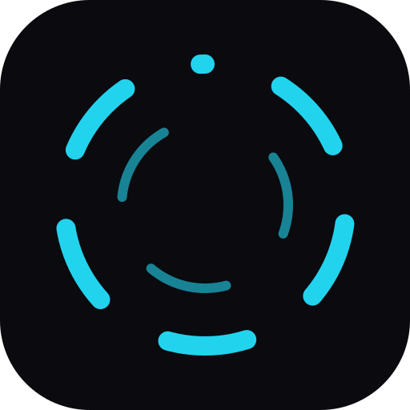
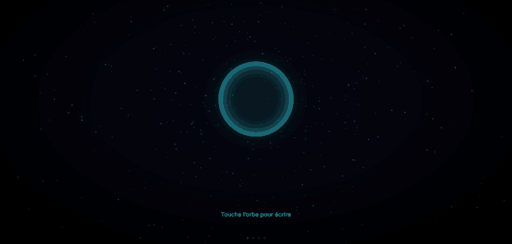
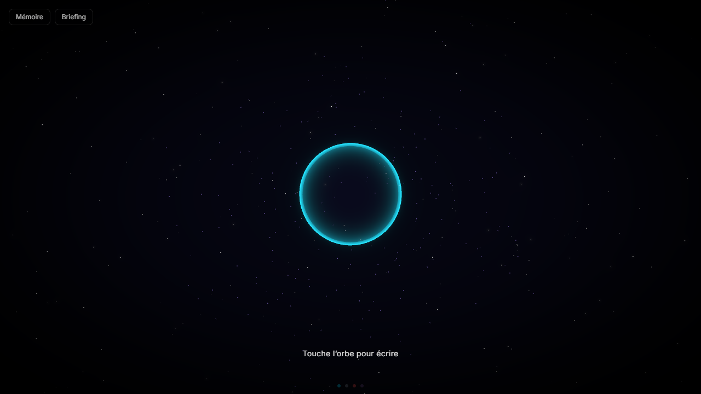
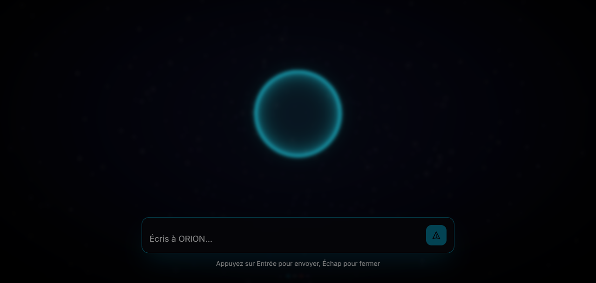

<p align="center">
  
</p>

<h1 align="center">ORION</h1>

<p align="center">
  <strong>Un assistant IA personnel qui vit sur votre PC.</strong><br>
  Il agit, se souvient, et choisit le bon moment pour vous parler.
</p>

<p align="center">
  
</p>

Le projet est en développement actif : l'API et les schémas peuvent évoluer.

## Pourquoi ORION

- **Il agit, sous votre contrôle.** 24 outils sont exposés au modèle, dont les actions du poste Windows :
  fichiers, git, processus, presse-papiers, écran. Toute action destructive attend votre confirmation.
- **Il se souvient.** Chaque échange alimente une mémoire à long terme (pgvector), consolidée automatiquement en
  règles, décisions, état en cours et références.
- **Il sait quand se taire.** Des watchers observent l'activité du poste (inactivité, charge, applications, commits
  non poussés). Un décideur choisit d'émettre, de différer ou d'écarter chaque signal, et ajuste ses choix d'après vos
  retours.
- **Il ne dépend pas d'un seul fournisseur.** Le LLM, la transcription et la synthèse vocale passent par des cascades :
  si un fournisseur échoue, le suivant prend le relais.
- **Il rattrape le poste éteint.** Les actions demandées quand le PC est éteint s'exécutent à son retour ; les
  actions destructives passent d'abord par une confirmation à l'écran.
- **Il se parle comme il s'écrit.** Conversation vocale full-duplex avec détection de parole Silero et
  interruption à tout moment, ou saisie au clavier.

## Aperçu

<table>
  <tr>
    <td align="center"><br><sub>Accueil</sub></td>
    <td align="center"><br><sub>Saisie</sub></td>
  </tr>
</table>

Captures de l'interface en développement local, sans backend connecté.

## Architecture

```
┌──────────────────────────────────────────────────────────────┐
│  Frontend : React 19, Vite, PWA                              │
│    Scène 3D · HUD · VAD Silero · SSE · WebSocket /ws/voice   │
├──────────────────────────────────────────────────────────────┤
│  Backend : .NET 9, Clean Architecture                        │
│    IAgentLoop → ILLMAgentClient (LLMCascade)                 │
│    IToolInvoker : exécute, diffère ou refuse                 │
│    Mémoire : pgvector + mistral-embed                        │
│    Authentification : JWT et secret partagé du daemon        │
├──────────────────────────────────────────────────────────────┤
│  Daemon : .NET 9 Worker, session utilisateur Windows         │
│    Connexion sortante vers le backend · 20 actions           │
│    Watchers · notifications · synthèse Kokoro locale         │
├──────────────────────────────────────────────────────────────┤
│  Données : PostgreSQL + pgvector (Supabase)                  │
└──────────────────────────────────────────────────────────────┘
```

| Couche | Technologies |
|---|---|
| Frontend | React 19, Vite, TypeScript strict, TailwindCSS, Three.js |
| Backend | .NET 9, EF Core |
| LLM | NVIDIA NIM (compatible OpenAI), repli Ollama |
| Embeddings | `mistral-embed`, 1024 dimensions |
| Transcription | Voxtral, repli Whisper.net |
| Synthèse vocale | Voxtral TTS, repli Kokoro |
| Base de données | PostgreSQL 15+ avec pgvector |
| Recherche web | DuckDuckGo, Brave, SerpAPI |

## Démarrer

Prérequis : SDK .NET 9, Node.js 20 ou plus récent, PostgreSQL 15+ avec pgvector, une clé Mistral (embeddings,
transcription, voix), une clé NVIDIA NIM ou Ollama pour un fonctionnement local. Windows pour le daemon.

```bash
# Base de données
psql "$CONNECTION_STRING" -f memory/schema.sql   # puis memory/migrations/ dans l'ordre

# Backend (http://localhost:5107)
cp .env.example .env
dotnet run --project backend/Orion.Api

# Frontend (http://localhost:3000)
cd frontend && cp .env.example .env && npm install && npm run dev
```

```powershell
# Daemon Windows
powershell -File scripts/install-daemon.ps1
```

Les variables d'environnement sont décrites dans [docs/deployment.md](docs/deployment.md).

| Commande | Effet |
|---|---|
| `dotnet test backend/Orion.sln` | Tests du backend |
| `dotnet test daemon/Orion.Daemon.sln` | Tests du daemon |
| `cd frontend && npm run build` | Build du frontend |

## Structure du dépôt

```
backend/    Orion.Api · Orion.Business · Orion.Core · Orion.Data · Orion.Tests
daemon/     Orion.Daemon · Orion.Daemon.Core · Orion.Daemon.Actions · Orion.Daemon.Tests
frontend/   composants, hooks, services, types
memory/     schéma SQL, migrations
scripts/    installation du daemon
docs/       documentation
```

## Documentation

| Document | Contenu |
|---|---|
| [docs/architecture.md](docs/architecture.md) | couches, cascades, mémoire, authentification |
| [docs/data-model.md](docs/data-model.md) | tables et migrations |
| [docs/tools.md](docs/tools.md) | catalogue d'outils et création d'un outil |
| [docs/voice.md](docs/voice.md) | pipeline vocal |
| [docs/proactivity.md](docs/proactivity.md) | watchers et décision proactive |
| [docs/daemon.md](docs/daemon.md) | daemon Windows |
| [docs/frontend.md](docs/frontend.md) | PWA |
| [docs/deployment.md](docs/deployment.md) | configuration, déploiement, CI |
| [docs/security.md](docs/security.md) | modèle de menace, contrôles, signalement |
| [docs/roadmap.md](docs/roadmap.md) | état et prochaines étapes |
| [AGENTS.md](AGENTS.md) | règles de contribution et décisions d'architecture |

## Licence

Distribué sous licence MIT. Voir [LICENSE](LICENSE).
