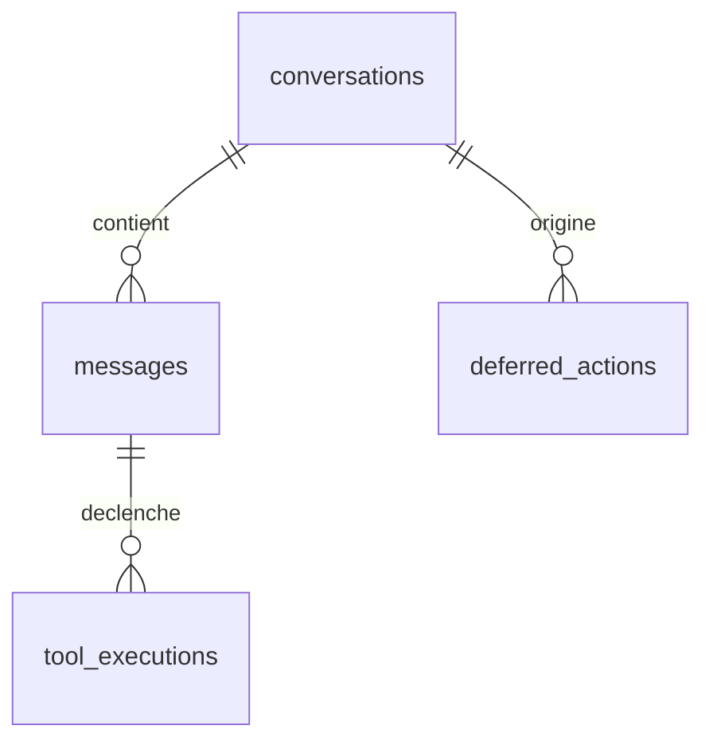

# Modèle de données

PostgreSQL avec l'extension pgvector. Le schéma de base se trouve dans `memory/schema.sql`, les
évolutions dans `memory/migrations/`.

## Tables

| Table | Rôle |
|---|---|
| `conversations` | sessions de conversation |
| `messages` | messages d'une conversation |
| `memory_vectors` | mémoire long terme et embeddings |
| `user_profile` | profil clé-valeur |
| `tool_executions` | journal d'exécution des outils |
| `audit_logs` | traçabilité des opérations |
| `behavior_patterns` | comportements observés par les watchers |
| `deferred_actions` | file d'actions différées ou en attente de confirmation |

## Relations

## `deferred_actions`

| Colonne | Description |
|---|---|
| `tool_name`, `arguments` | outil et arguments demandés |
| `status` | `pending`, `awaiting_confirmation`, `executed`, `failed`, `expired`, `cancelled` |
| `is_destructive` | régime figé au moment de la demande |
| `origin` | origine de la demande |
| `conversation_id`, `requested_by` | contexte de la demande |
| `requested_at`, `expires_at`, `resolved_at` | cycle de vie |
| `result`, `error` | résultat d'exécution |

## Embeddings

La colonne `memory_vectors.embedding` doit correspondre à `Embedding:Dimensions`. La migration
`005_embedding_1024_mistral.sql` la fixe à 1024 dimensions. pgvector limite ses index à 2000
dimensions.

Changer de modèle impose `POST /api/memory/revectorize`.

## Migrations

Les fichiers `memory/migrations/NNN_description.sql` s'appliquent dans l'ordre, après
`memory/schema.sql`. Une nouvelle table active RLS, et les clés d'API restent hors de la base.
